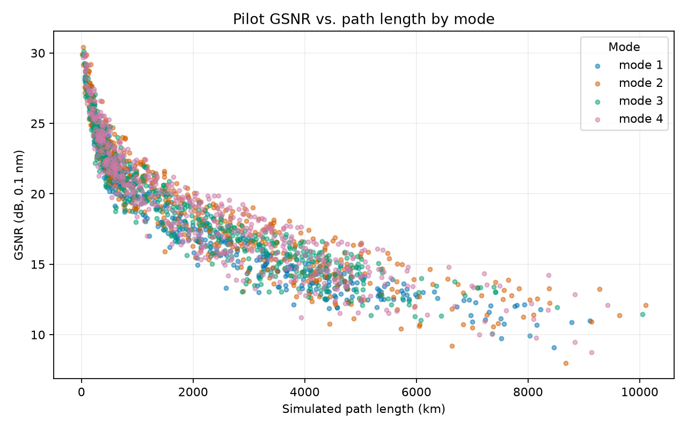
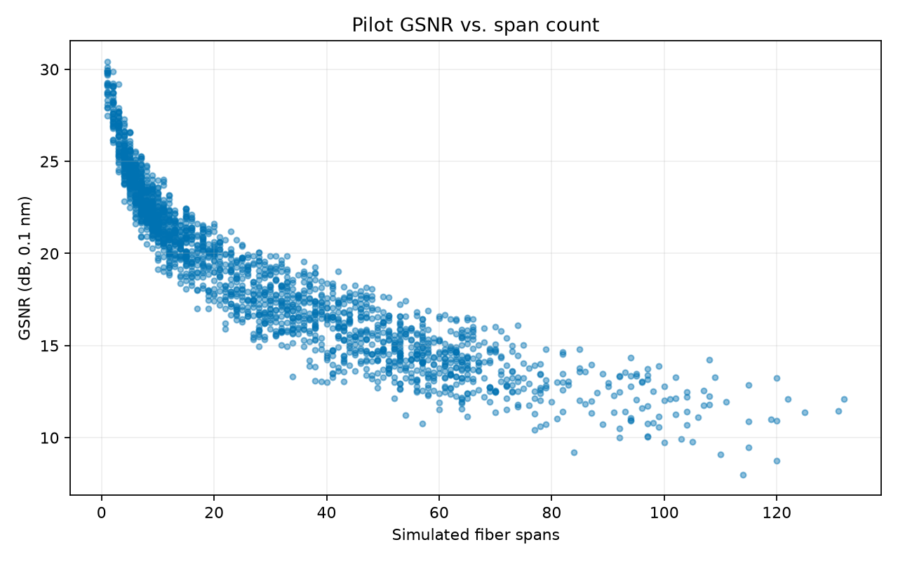
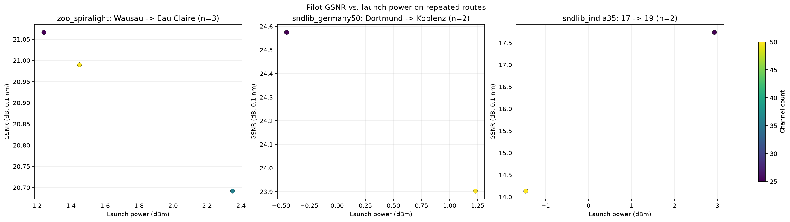
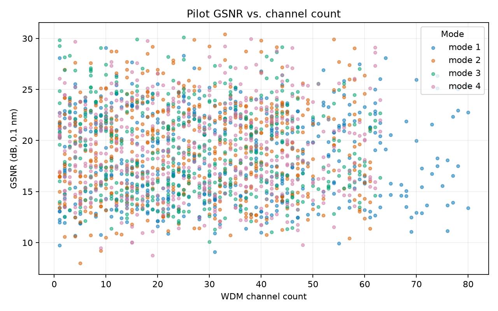

# CP2B Phase 2 dataset-quality pilot

## Status and run identity

The pilot completed with exactly 2,000 requested scenarios using two workers. Results below are from the
generated run, not extrapolated. The full dataset was not generated.

- Run ID: `cp2b-pilot`
- Seed: `20261123`
- GNPy: `3.0.1`
- Commit recorded in manifest: `a1a18812cf3dfb278c2f0d38bb39b63deba9f83a`
- Output: `data/generated/cp2b-pilot/`

Command executed on Windows:

```powershell
$env:PYTHONPATH='src'; .\.venv\Scripts\python.exe scripts\phase2_generate.py --runs 2000 --chunk-size 500 --workers 2 --run-id cp2b-pilot
```

## 1. Run counts and failures

| Requested | Attempted | Successful | Failed | Rejected |
|---:|---:|---:|---:|---:|
| 2,000 | 2,000 | 2,000 | 0 | 0 |

No simulation failure reasons were recorded. The merged output contains 2,000 path rows and 61,476 span rows.

## 2. Scenario uniqueness

- Unique `scenario_id` values: 2,000 / 2,000.
- Duplicate `scenario_id` values: 0.
- Unique-scenario ratio from the manifest: 1.0.

## 3. Runtime

- Two-worker elapsed time: 3,011.997 seconds (50 minutes, 11.997 seconds).
- Measured throughput: 1,506.0 seconds per 1,000 requested scenarios (25 minutes, 6 seconds).
- Linear estimate for 100,000 scenarios at the same measured throughput: 150,599.9 seconds, or 41.83 hours.

The 100,000-row value is an estimate based on this pilot, not a measured runtime. It does not account for
machine load or scenario-distribution changes at larger scale.

## 4. Scenario distributions

All 18 accepted topologies were represented: 16 had 111 rows and 2 had 112 rows.

| Measure | Min | Median | Mean | P90 | Max |
|---|---:|---:|---:|---:|---:|
| Simulated path length (km) | 9.032 | 1,704.628 | 2,256.564 | 4,879.806 | 10,111.603 |
| Fiber spans | 1 | 24 | 30.738 | 65 | 132 |
| WDM channels | 1 | 27 | 28.551 | 54 | 80 |
| Launch power (dBm) | -3.00 | -0.05 | -0.023 | 2.37 | 2.99 |

Mode counts: mode 1 = 502 (25.10%), mode 2 = 505 (25.25%), mode 3 = 490 (24.50%), mode 4 = 503 (25.15%).

Route-rank counts: rank 1 = 799, rank 2 = 622, rank 3 = 579. The largest observed product of channel count
and spacing was 4,725 GHz, below the configured 4,750 GHz band; there were zero band-limit violations.

## 5. Feasibility-label comparison

Both conventions were evaluated on the same 2,000 successful rows. The old convention compares signal-band
`gsnr_db` directly to a 0.1 nm OSNR requirement plus design margin; it is retained here only as a historical
comparison. The adopted convention uses `gsnr_db_01nm`.

| Mode | Rows | Old feasible | Old share | New feasible | New share |
|---|---:|---:|---:|---:|---:|
| mode 1 | 502 | 247 | 49.20% | 406 | 80.88% |
| mode 2 | 505 | 1 | 0.20% | 105 | 20.79% |
| mode 3 | 490 | 37 | 7.55% | 204 | 41.63% |
| mode 4 | 503 | 44 | 8.75% | 285 | 56.66% |
| **Overall** | **2,000** | **329** | **16.45%** | **1,000** | **50.00%** |

The `feasible` column matched the recomputed new convention on all rows.

## 6. Physical sanity checks and plots

All plotted GSNR values use the primary 0.1 nm target.



**PASS (descriptive distance trend):** Spearman correlations between path length and GSNR were negative for
every mode: mode 1 = -0.9765, mode 2 = -0.9570, mode 3 = -0.9638, and mode 4 = -0.9485.



**PASS (descriptive span trend):** The pooled Spearman correlation between span count and GSNR was -0.9615.



**FAIL / insufficient evidence for the optimum check:** The most-repeated route occurred only three times;
no exact route/mode/channel-count/spacing combination had three or more samples. The plotted routes therefore
do not form controlled launch-power sweeps, and the pilot cannot establish an ASE/NLI optimum. The pooled
launch-power/GSNR Spearman correlation was +0.2024 and is confounded by route, mode, and channel count.



**FAIL / inconclusive channel-load check:** The pooled channel-count/GSNR Spearman correlation was +0.0005.
Because route, mode, launch power, and spacing vary together in this random sample, it does not isolate a
channel-count effect and cannot establish the expected load trend.

## 7. Per-span checks

| Check | Result |
|---|---:|
| Intended route equals GNPy simulated route | 2,000 / 2,000 |
| Span count agrees with path row | 2,000 / 2,000 |
| Total path length equals sum of span lengths within 1e-6 km | 2,000 / 2,000; maximum error 9.1e-13 km |
| Cumulative signal-band GSNR non-increasing within 1e-6 dB | 2,000 / 2,000 |
| Cumulative 0.1 nm GSNR non-increasing within 1e-6 dB | 2,000 / 2,000 |
| Last-span GSNR equals path GSNR in both bandwidths within 1e-6 dB | 2,000 / 2,000; max error 0 dB |
| Path has at least one non-zero `gsnr_drop_db` | 2,000 / 2,000 |
| Amplifier output exceeds post-fiber power | 61,476 / 61,476 span rows |
| Maximum span length | 79.9993 km (at or below configured 80 km) |

There were 33 null NLI SNR values in each bandwidth among 61,476 spans. All 33 in each bandwidth were flagged
invalid because the inverse-SNR subtraction was non-positive; these are explicit nulls, not clipped estimates.
The run manifest reports zero nulls for all other required path/span columns.

## 8. GNPy warnings before and after WI-4

These are the measured Phase 1 per-topology design-warning counts from the WI-4 comparison, not a count inferred
from pilot stdout. The pilot generator did not capture simulation warnings by topology. The repeated Roadm
`type_variety` default warning was observed in pilot logs; it is an equipment-load warning, not a per-topology
design-warning count.

| Topology | Before WI-4 | After WI-4 |
|---|---:|---:|
| sndlib_germany50 | 128 | 0 |
| sndlib_india35 | 116 | 0 |
| sndlib_nobel-germany | 34 | 0 |
| tunisia | 14 | 0 |
| zoo_aarnet | 44 | 0 |
| zoo_agis | 42 | 0 |
| zoo_attmpls | 86 | 0 |
| zoo_bbnplanet | 42 | 0 |
| zoo_bellcanada | 108 | 0 |
| zoo_bics | 72 | 0 |
| zoo_crlnetworkservices | 48 | 0 |
| zoo_darkstrand | 46 | 0 |
| zoo_elibackbone | 46 | 0 |
| zoo_geant2009 | 84 | 0 |
| zoo_goodnet | 46 | 0 |
| zoo_palmetto | 114 | 0 |
| zoo_sago | 16 | 0 |
| zoo_spiralight | 28 | 0 |
| **Total** | **1,114** | **0** |

## 9. Remaining limitations

- The random pilot does not provide enough repeated controlled settings to validate the launch-power optimum
  or isolate the channel-count effect.
- The GNPy Roadm equipment entry still omits `type_variety`; GNPy uses its default and logs a warning.
- SNDlib and Topology Zoo source/license terms are not fully verified; see `docs/ATTRIBUTION.md`.
- Topology graphs and the modeled route geometry are abstractions, not surveyed current fiber routes.
- Thirty-three span-level NLI results per bandwidth are correctly null and invalid under the required formula.

## 10. Recommendation

**NO-GO for the 100,000-row run at this checkpoint.** The generation, uniqueness, label, and per-span checks
passed, but the physical launch-power optimum and channel-load checks remain unvalidated by this random pilot.
Do not run the larger dataset until those controlled diagnostics are addressed and the user authorizes it.

If later authorized, the exact Windows command at the measured two-worker configuration is:

```powershell
$env:PYTHONPATH='src'; .\.venv\Scripts\python.exe scripts\phase2_generate.py --runs 100000 --chunk-size 500 --workers 2 --run-id cp2b-full
```

Estimated duration: **about 41.83 hours** at the pilot's measured throughput; this is a linear estimate, not a
guaranteed runtime. No 100,000-row generation was started.
